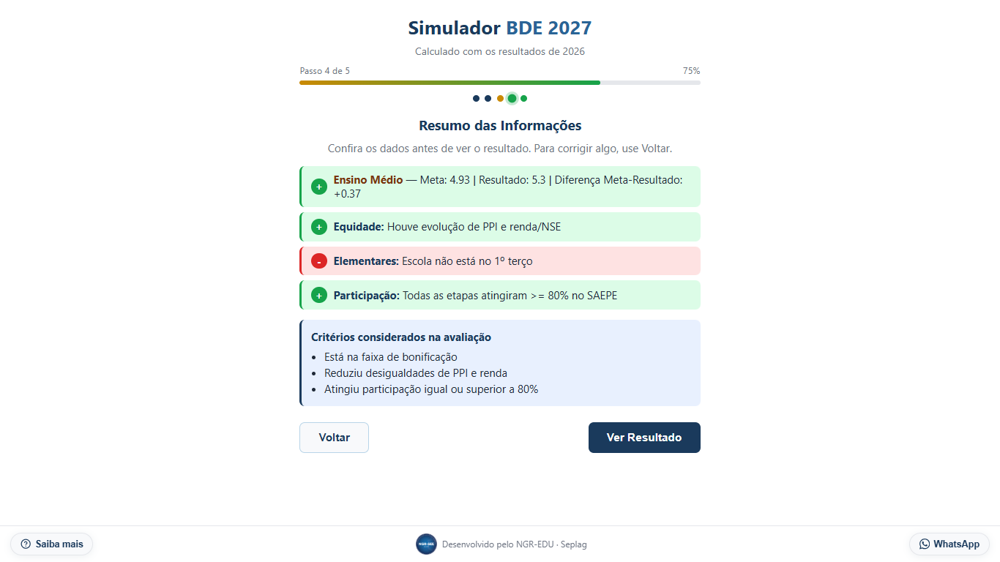

# Simulador BDE



Aplicação web para apoiar gestores escolares de Pernambuco na simulação do Bônus de Desempenho Educacional (BDE), com preenchimento guiado e apresentação detalhada dos resultados.

## O que e?

O Simulador BDE foi desenvolvido pelo Nucleo de Gestao para Resultados na Educacao (NGR-SEE) / Seplag para facilitar a vida dos gestores escolares. Antes, o calculo do BDE era feito manualmente em planilhas Excel. Agora, basta preencher os dados em um passo a passo guiado e o sistema faz todo o calculo automaticamente.

## Funcionalidades

- **Wizard passo a passo**: navegacao intuitiva em etapas
- **Calculo automatico**: formula exata da planilha original
- **Resultado detalhado**: visualizacao de cada componente do BDE
- **Explicacoes interativas**: clique nos cards do resultado para entender cada metrica
- **Contato integrado**: WhatsApp para suporte

## Executar localmente

Requer Python 3.9 ou superior.

```powershell
py -m venv .venv
.\.venv\Scripts\Activate.ps1
python -m pip install -r requirements.txt
python -m uvicorn main:app --reload
```

Acesse <http://127.0.0.1:8000>.

## Testes

```powershell
python tests/test_cenarios.py
python tests/test_limites.py
python tests/test_paridade.py
```

O teste de paridade também requer Node.js.

## Estrutura

- `app/`: interface e recursos web.
- `src/bde/`: API e serviço da aplicação.
- `tests/`: verificações automatizadas.
- `tools/`: ferramentas auxiliares.
